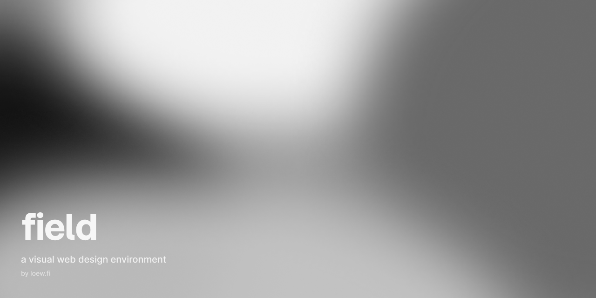

# field

A visual web design environment by loew.fi. Shape a page on the canvas, work on its content and code, and see the website running in Preview.

**The design is the real website.** Source stays part of the project, rather than becoming a one-time export. When the editor and running site disagree, that's a bug to investigate.

field is in active development. This repository contains the editor and its separate Canvas and Preview runtimes.

## Find your way around

- **Design:** compose layouts, typography, components, assets, and interactions.
- **Content:** work on copy, structured content, metadata, and localization.
- **Code:** inspect and edit the project's source.
- **Preview:** check what the website actually does.

## Run locally

You need Node.js 22 or newer and npm.

```sh
npm ci
npm run dev
```

Open http://localhost:3333. The command also starts Canvas on port 5174 and Preview on port 5175; keep all three running. Local projects are stored in your browser by default. Cloud services need separate configuration; start with [`.env.example`](.env.example).

## Development

```sh
npm run test:run
npm run lint
npm run build:all
npm run e2e
```

These run the unit tests, lint checks, production builds, and browser tests, respectively. See [CONTRIBUTING.md](CONTRIBUTING.md) for the contribution workflow.

The editor lives in `src/editor/`, Canvas in `src/canvas/` and `src/canvas-sandbox/`, and Preview in `src/preview-sandbox/`. Project and document logic is primarily in `src/code/`; backend integration is in `src/backend/`.

## License and upstream work

field is a modified derivative of Revyme, licensed under [AGPL-3.0-only](LICENSE). [NOTICE](NOTICE) records the required upstream attribution and additional terms. Keep both files with redistributed copies.

Some Revyme names remain in dependencies, protocols, and storage for compatibility.
